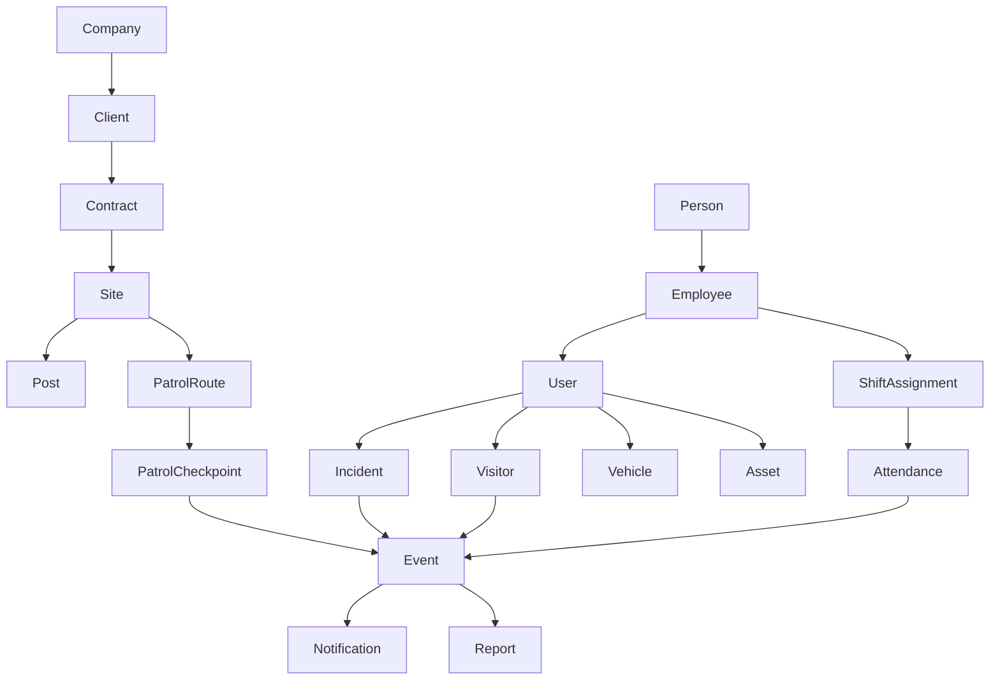
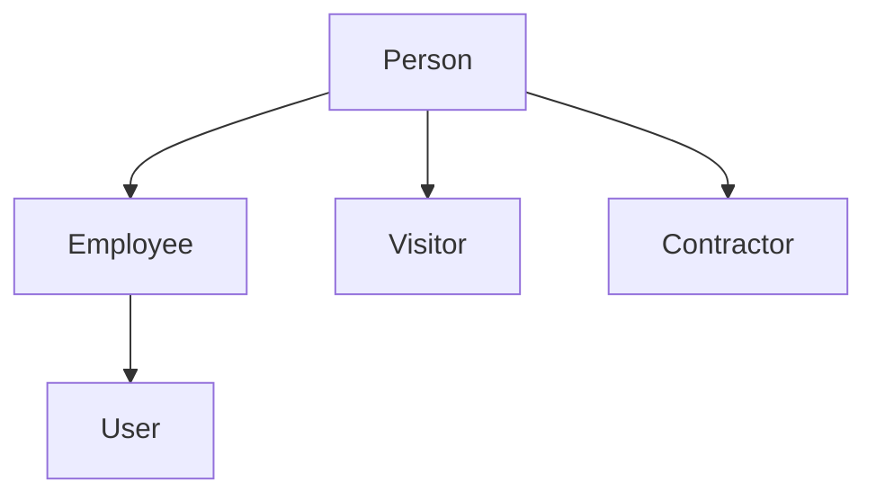
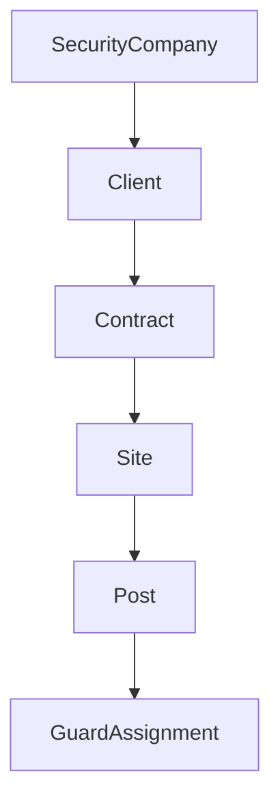
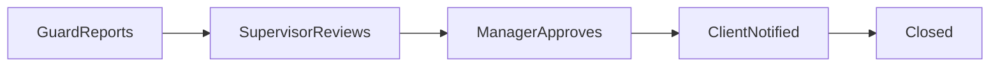
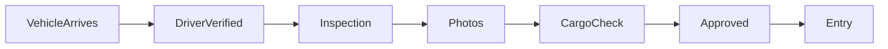

# Sentinel Core Business Objects

## Rule

No table exists unless it solves a real business problem.

## Core Object Catalog

Primary business objects (about 15):

- Company
- Client
- Site
- Person
- Employee
- User
- Shift
- Attendance
- Patrol
- Incident
- Visitor
- Vehicle
- Asset
- Report
- Notification

Supporting objects that operationalize the model:

- Contract
- Post
- Shift Assignment
- Patrol Route
- Patrol Checkpoint
- Event

## Core Structure

## Person-Centered Identity Model

This model enforces one person record with many contextual roles.

## Company Delivery Hierarchy

Contracts are first-class business objects because service delivery is time-bound and billable.

## Contract Minimum Data

- contract_id
- client_id
- contract_number
- contract_name
- start_date
- end_date
- monthly_value
- status
- created_at
- updated_at

## Post Minimum Data

- post_id
- site_id
- post_name
- description
- gps_lat
- gps_long
- status

## Key Modeling Principles

- Person is the canonical identity object; employees, visitors, and contractors attach to person.
- Sites belong to contracts; this enables billing, SLA, and staffing traceability.
- Posts are the real operational unit where guards are assigned and verified.
- Patrols are measured through routes and checkpoints, not generic site-level flags.
- Attendance is linked to shift assignments and posts for actionable supervision.
- Every major workflow step should emit events for auditability and automation.

## Workflow Baselines

Visitor workflow:

Incident workflow:

Vehicle workflow:

Fire drill workflow:

## Attendance Verification Layers

- Clock In
- GPS verification
- QR verification
- Face verification (future)
- NFC verification (future)

## Dashboard Outcome Standard

The supervisor dashboard must answer these within 30 seconds:

1. What needs attention right now?
2. Where are my guards?
3. What incidents are still open?
4. Are patrols being completed?
5. What should I do next?

## Notification Priority Standard

- Information
- Success
- Warning
- Critical
- Emergency

## AI Assistant Direction

AI in Sentinel must support conversational operations, not only report generation.

Examples:

- Show me incidents from Gate 3 this week involving trucks.
- Which guards have been late more than three times this month?

## API Versioning Rule

All platform capabilities are exposed under versioned API namespaces starting at /api/v1.

## Business Questions This Model Answers

- Which contracts are active and profitable per client?
- Which posts are understaffed tonight?
- Which assigned guards did not clock in at assigned posts?
- Which patrol routes are incomplete and where?
- Which incidents remain open by site, post, and shift?
