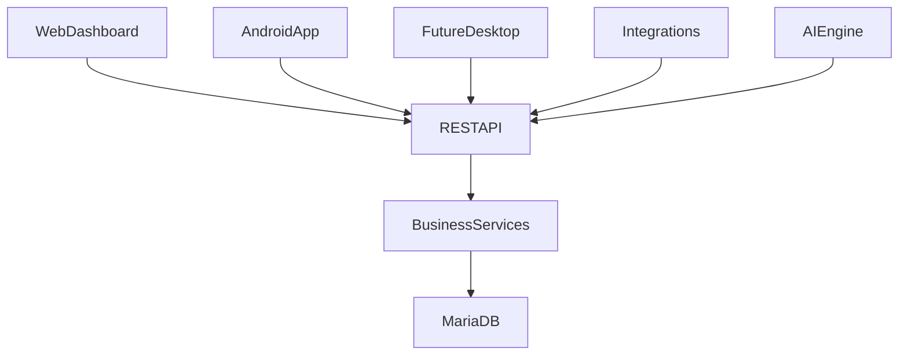

# ADR: API-First Architecture

## Status

Accepted

## Decision

Sentinel is API-first from v1. All first-party and third-party clients must consume the same REST API layer.

This includes the web dashboard, which must not bypass service-layer APIs to query application tables directly.

## Required Access Pattern

## Why

- One backend behavior across web, mobile, AI, and integrations.
- Security, validation, and auditing are centralized.
- Versioning and backward compatibility become manageable.
- New channels (desktop, iOS, Sentinel OS) can ship without business-logic rewrites.

## Non-Goals

- No client may bypass API and read/write production tables directly.
- No UI-specific business logic in frontend clients.

## Implementation Rules

- API namespace starts at `/api/v1`.
- External responses expose UUID identifiers where available.
- Tenant isolation is enforced in service layer and data access layer.
- All write operations emit audit/event records.
- Contracts are the parent of operational sites in service-level business flows.
- Shift assignment is mandatory context for attendance, patrol accountability, and guard performance.
- All workflow transitions (visitor, incident, vehicle, fire drill) are evented for traceability and notifications.

## Core Resource Surface (v1)

- Authentication
- Companies
- Clients
- Contracts
- Sites
- Posts
- Persons
- Employees
- Users
- ShiftAssignments
- Attendance
- PatrolRoutes
- PatrolCheckpoints
- Incidents
- Visitors
- Vehicles
- Assets
- Events
- Notifications

## Delivery Sequence

1. Database and migrations
2. REST API and business services
3. Web dashboard consuming API
4. Android app consuming same API
5. AI assistant consuming same API

## Immediate Next Modules

- Authentication and JWT
- Company, client, contract, site, post APIs
- Shift assignment and attendance APIs
- Patrol route/checkpoint APIs
